# Random Quote Generator (separate files)

<div align="center">




</div>

Learn and practice:
- Conditionals and the ternary operator
- Loops and array methods
- Arrow functions
- Objects, DOM manipulation, and events

## What you build
A small app that:
- Generates a random quote (never the same twice in a row)
- Lets you add new quotes (automatic `id`, starts at 0)
- Likes the current quote
- Shows character and word counts for the current quote
- Filters quotes by author with Previous/Next navigation

## Files
```
random-quote-generator/
├─ index.html
├─ css/
│  └─ styles.css
└─ js/
   └─ app.js
```

## Run
Open `index.html` in your browser.

## UI
- 🔁 **Generate Quote**: shows a random quote (not the same as the immediately previous one).
- 👍 **Like**: increments the like count for the shown quote.
- 🔡 **Chars (with spaces / no spaces)** and 🧮 **Word count**: display metrics for the current quote.
- ➕ **Add a quote**: submit text and author to append to the list (id auto-increments).
- 🔎 **Filter by author**: type a name (case-insensitive contains), then use ⏮️/⏭️ to navigate results. **Clear** resets the view.

## Notes
- Emojis are used for clarity; no hearts.
- IDs are assigned as `maxId + 1` for robustness.
- Random selection ignores any active filter; filtered results are navigated with Previous/Next.
- All logic uses plain JavaScript and DOM APIs.
