# 🎨 Styles - Random Quote Generator

The look of the quote app: a dark theme built on CSS variables.

## Contents

- [`styles.css`](styles.css): the cards, the big blockquote, the byline with the like badge, button rows and form fields

---

## 👤 Author

**Kevin Cusnir 'Lirioth'**  
Repository: [Fullstack2026](https://github.com/LiriothTeltanion/Fullstack2026)  
Week 4 Day 3 - HTTP and GET/POST Forms - Random Quote Generator
