# Js

<div align="center">




</div>

JavaScript modules for this exercise.

## Contents

- [`app.js`](app.js)

## Run

From the repository root:

```bash
node Week4AdvAsynchronousJavaScript/Day3HTTPAndFormMethodGETAndPOST/Exercises/RandomQuoteGenerator/js/app.js
```
