# 🌐 Day 3 — HTTP and GET/POST Forms

Day 3 of Week 4: how forms send data with GET and POST, reading query strings, JSON, and a small quote app.

## Contents

| Folder | What it is |
|---|---|
| [`Exercises/`](Exercises/) | Exercises XP, Exercises XP Gold and the Random Quote Generator |
| [`DailyChallenge/`](DailyChallenge/) | HTML Form and True or False |

---

## 👤 Author

**Kevin Cusnir 'Lirioth'**  
Repository: [Fullstack2026](https://github.com/LiriothTeltanion/Fullstack2026)  
Week 4 Day 3 - HTTP and GET/POST Forms
