# 💪 Daily Challenge - Play With Words

<div align="center">




</div>

Two promise chains in `daily_promises_morse.js`: one upper-cases and sorts a list of words, the other turns text into Morse code.

## ▶️ How to run

Open `index_daily_challenges.html` in a browser. The script needs `document` and `prompt`, so Node can't run it.

The third test button resolves with:

```
["APPLE","BANANA","KIWI","MELON","PEAR"]
```

Typing `Hi there!` and pressing **Translate** prints one code per line (the space becomes `/`):

```
....
..
/
-
....
.
.-.
.
-.-.--
```

## 🎯 The challenge

| Function | What it does |
|---|---|
| `makeAllCaps(arr)` | Resolves with every word in capitals, or rejects if an item is not a string |
| `sortWords(arr)` | Resolves with a sorted copy when there are more than 4 words, otherwise rejects |
| `toJs()` | Parses the `morse` JSON string into an object |
| `toMorse(morseJS)` | Reads the text box (or asks with `prompt`) and resolves with one code per character, or rejects on an unknown one |
| `joinWords(morseArr)` | Joins the codes with line breaks and writes them into `#morseOut` |

Test 1 rejects (a number in the list), test 2 rejects (only three words), test 3 resolves.

## 🧠 What I learned

- When a `.then()` returns a promise, the next `.then()` waits for it
- One `.catch()` at the end catches a rejection from any step of the chain
- `JSON.parse` is strict: a single comment makes the whole parse fail

---

## 👤 Author

**Kevin Cusnir 'Lirioth'**  
Repository: [Fullstack2026](https://github.com/LiriothTeltanion/Fullstack2026)  
Week 4 Day 4 - Asynchronous JavaScript - Daily Challenge
