# 💪 Daily Challenges

The Day 4 daily challenge.

## Contents

- [`PlayWithWords/`](PlayWithWords/) — `makeAllCaps` and `sortWords` chained together, and a Morse translator built from promises

---

## 👤 Author

**Kevin Cusnir 'Lirioth'**  
Repository: [Fullstack2026](https://github.com/LiriothTeltanion/Fullstack2026)  
Week 4 Day 4 - Asynchronous JavaScript - Daily Challenges
