# 🥉 Exercises XP

<div align="center">




</div>

Three promise exercises in `promises.js`, each with a test button in `index_promises.html`.

## ▶️ How to run

Open `index_promises.html` in a browser, open DevTools → Console and click the buttons. The script needs `document`, so not Node.

**Test compareToTen** runs 15 and then 8, but the console prints 8 first, because the rejection of 15 passes through an extra `.then()`:

```
OK: 8 <= 10
Error: 15 is greater than 10
```

## 🎯 The challenge

1. **`compareToTen(num)`**: resolves with `OK: num <= 10` or rejects with `Error: num is greater than 10`.
2. **`delayedSuccess`**: resolves with `"success"` from a 4-second `setTimeout`.
3. **`pResolved` / `pRejected`**: `Promise.resolve(3)` and `Promise.reject("Boo!")`, read with `.then()` and `.catch()`.

All three promises are made when the page loads, so the 4-second timer starts then, not on the click.

## 🧠 What I learned

- The `new Promise` executor runs right away, so creating a promise already starts the work
- A rejection skips every `.then()` until it reaches a `.catch()`
- `.then()` callbacks run as microtasks, which explains the order in the console

---

## 👤 Author

**Kevin Cusnir 'Lirioth'**  
Repository: [Fullstack2026](https://github.com/LiriothTeltanion/Fullstack2026)  
Week 4 Day 4 - Asynchronous JavaScript - Exercises XP
