# 🥇 Exercises XP Gold

<div align="center">




</div>

Timers and promises in [asyncGold.js](asyncGold.js). Every "download" is a fake delay made with `setTimeout`, so the timings are easy to see.

## ▶️ How to run

```bash
node asyncGold.js
```

```
2. Sequential took about 1.0 s -> [ 'a (500 ms)', 'b (500 ms)' ]
   Parallel took about 0.5 s -> [ 'a (500 ms)', 'b (500 ms)' ]
3. fast (100 ms)
   timed out after 300 ms
4.
   fulfilled: one (50 ms)
   rejected: server error
   fulfilled: three (80 ms)
5.
   attempt 1 failed, waiting 100 ms
   attempt 2 failed, waiting 200 ms
   ok on attempt 3
```

## 🎯 The challenge

1. `sleep(ms)` wraps `setTimeout` in a promise, and `download(name, ms)` uses it.
2. Two downloads with `await` one after the other take about 1 second; with `Promise.all()` they take about 0.5.
3. `withTimeout(promise, ms)` races the real promise against one that rejects after `ms`.
4. `Promise.allSettled()` reports every result, even when one of them fails.
5. `retry(task)` calls `flakyRequest()` again after a wait that doubles each time (100, 200 ms…). The fake request fails twice and succeeds on the third call.

## 🧠 What I learned

- `await` inside a sequence makes the waits add up; starting the promises first and awaiting them together doesn't
- `Promise.race()` settles with whichever promise finishes first, which is all a timeout needs
- With `allSettled()` I read `status`, then `value` or `reason`, instead of catching errors

---

## 👤 Author

**Kevin Cusnir 'Lirioth'**  
Repository: [Fullstack2026](https://github.com/LiriothTeltanion/Fullstack2026)  
Week 4 Day 4 - Asynchronous JavaScript - Exercises XP Gold
