# 📚 Exercises

One XP set with three promise exercises.

## Contents

- [`ExercisesXP/`](ExercisesXP/): `compareToTen`, a promise that waits 4 seconds, and `Promise.resolve` / `Promise.reject`
- [`ExercisesXPGold/`](ExercisesXPGold/): Exercises XP Gold: to do (optional)

---

## 👤 Author

**Kevin Cusnir 'Lirioth'**  
Repository: [Fullstack2026](https://github.com/LiriothTeltanion/Fullstack2026)  
Week 4 Day 4 - Asynchronous JavaScript - Exercises
