# ⏳ Day 4 — Asynchronous JavaScript

<div align="center">




</div>

Build resilient asynchronous flows with HTTP requests, loading states, validation, and error handling.

## Contents

- [`DailyChallenge/`](DailyChallenge/)
- [`Exercises/`](Exercises/)

## Run

From the repository root:

```bash
node Week4AdvAsynchronousJavaScript/Day4AsynchronousJavaScript/DailyChallenge/PlayWithWords/daily_promises_morse.js
python -m http.server 8000
node Week4AdvAsynchronousJavaScript/Day4AsynchronousJavaScript/Exercises/ExercisesXP/promises.js
```
