# 🏆 Daily Challenge - Gifs

<div align="center">




</div>

I type a category and the page asks Giphy for one random GIF with that tag. Each GIF arrives with its own DELETE button, and a DELETE ALL button clears the whole list.

## ▶️ How to run

1. Copy `js/config.example.js` to `js/config.js` and put your Giphy key in it. `config.js` is ignored by Git.
2. From the repository root:

```bash
npm run dev
```

3. Open `http://localhost:8000/Week4AdvAsynchronousJavaScript/Day5FetchAndAsyncAwait/DailyChallenge/GifsReference/`, type a word like `sun` and press Search.

With no `config.js`, or with the `YOUR_...` placeholder still in it, the status line says the key is missing instead of breaking the page.

## 🎯 The challenge

| Requirement | Where it lives |
|---|---|
| Form with an input and a button | `index.html`: `#gif-form`, `#category` |
| One random GIF for the category | `fetchRandomGif()` calls `/v1/gifs/random` with `tag` |
| GIF URL from the `images` sub-object | `renderGif()` uses `gif.images.fixed_height.url` |
| DELETE next to each GIF | Each card has its own button that removes only that card |
| DELETE ALL | `gifList.replaceChildren()` empties the list |

Empty search, no match, a bad key and no network each show a message in the status line.

## 🧠 What I learned

- The random endpoint answers 200 with an empty `data` array when nothing matches, so I check for `images` before drawing
- `fetch` only fails without a network; a 401 from a wrong key reaches `response.ok`
- Giving every card its own listener keeps DELETE simple: the button already knows its card
- A key used in the browser can be read by anyone, so mine stays in `config.js` and never in Git

---

## 👤 Author

**Kevin Cusnir 'Lirioth'**  
Repository: [Fullstack2026](https://github.com/LiriothTeltanion/Fullstack2026)  
Week 4 Day 5 - Fetch and Async/Await - Daily Challenge Gifs
