# 🎨 Styles - Daily Challenge Gifs

The dark stylesheet behind the Gifs page.

## Contents

- [`styles.css`](styles.css): color variables, the search bar, the red DELETE buttons and the responsive GIF grid

---

## 👤 Author

**Kevin Cusnir 'Lirioth'**  
Repository: [Fullstack2026](https://github.com/LiriothTeltanion/Fullstack2026)  
Week 4 Day 5 - Fetch and Async/Await - Daily Challenge Gifs
