# 📜 Scripts - Daily Challenge Gifs

The two scripts that `../index.html` loads, `config.js` first and then `app.js`. Both expect a browser.

## Contents

- [`app.js`](app.js): `fetchRandomGif()`, `renderGif()`, the form handler and the DELETE ALL button
- [`config.example.js`](config.example.js): sets `window.GIPHY_CONFIG` with a placeholder; copy it to `config.js` (git-ignored) and add your own key

---

## 👤 Author

**Kevin Cusnir 'Lirioth'**  
Repository: [Fullstack2026](https://github.com/LiriothTeltanion/Fullstack2026)  
Week 4 Day 5 - Fetch and Async/Await - Daily Challenge Gifs
