# 🏆 Daily Challenge - Promise.all()

<div align="center">




</div>

Two cities, four coordinates, one button. The page asks the sunrise-sunset.org API for both sunrises at once and only shows them when both answers are back. Paris and New York are filled in already.

## ▶️ How to run

From the repository root:

```bash
npm run dev
```

Then open `http://localhost:8000/Week4AdvAsynchronousJavaScript/Day5FetchAndAsyncAwait/DailyChallenge/PromiseAll/` and press **Get both sunrises**. The API needs no key.

## 🎯 The challenge

- A form with four inputs: latitude and longitude for each city
- `getSunrise(lat, lng)` fetches one city and checks both `response.ok` and the API's own `status` field
- `Promise.all([...])` waits for both, so the result shows both sunrises or one error message, never half
- Times come back in UTC (`formatted=0`) and I print them as `HH:MM UTC`

With Paris (48.864716, 2.349014) and New York (40.730610, -73.935242) I got 07:14 and 11:54 UTC on 25 November 2026.

## 🧠 What I learned

- Both `fetch` calls start before the `await`, so the two requests run at the same time
- `Promise.all` rejects as soon as one promise fails, and one `try/catch` covers both cities
- This API answers 200 even for some bad input, so I read its `status` field too
- `type="number"` inputs still give strings, so I convert them with `Number()` and check `Number.isFinite`

---

## 👤 Author

**Kevin Cusnir 'Lirioth'**  
Repository: [Fullstack2026](https://github.com/LiriothTeltanion/Fullstack2026)  
Week 4 Day 5 - Fetch and Async/Await - Daily Challenge Promise.all()
