# 🏆 Daily Challenge

The two daily challenges of Week 4, Day 5: Fetch and async/await.

## Contents

- [`GifsReference/`](GifsReference/): Gifs: one random Giphy GIF per category, with DELETE and DELETE ALL
- [`PromiseAll/`](PromiseAll/): Promise.all(): the sunrise in two cities, shown only when both answers arrive

---

## 👤 Author

**Kevin Cusnir 'Lirioth'**  
Repository: [Fullstack2026](https://github.com/LiriothTeltanion/Fullstack2026)  
Week 4 Day 5 - Fetch and Async/Await - Daily Challenge
