# 🥉 Exercises XP

<div align="center">




</div>

Four exercises with the Fetch API and async/await. Each has a button in `index.html`; the full response goes to the console and a summary to the output panel.

## ▶️ How to run

1. Copy `js/config.example.js` to `js/config.js` and put your own restricted Giphy development key in it. `config.js` is ignored by Git.
2. From the repository root:

```bash
npm run dev
```

3. Open `http://localhost:8000/Week4AdvAsynchronousJavaScript/Day5FetchAndAsyncAwait/Exercises/ExercisesXP/`, open DevTools → Console and click each button.

`app.js` reads the key from `window.GIPHY_CONFIG.apiKey`. With no `config.js`, or with the `YOUR_...` placeholder still in it, exercises 1 and 2 show `Missing Giphy API key. ...`; 3 and 4 need no key.

## 🎯 The challenge

1. **Giphy "hilarious"**: logs the full JSON and shows the count plus the first GIF's title and URL.
2. **Giphy "sun"**: `limit=10` and `offset=2`, then shows the 10 titles.
3. **SWAPI starship 9**: `await` only, no `.then()`. Logs `result` and shows the starship's name.
4. **Analyse the snippet**: `asyncCall()` shows `calling` at once and `resolved` about 2 seconds later.

`handleStatus()` throws on any response that is not ok, and every handler is wrapped in `try/catch`, so errors land in the panel.

## 🧠 What I learned

- `fetch` resolves even on a 404 or 500, so checking `response.ok` is my job
- `await` pauses only its own function; the page keeps responding
- `new URL()` with `searchParams.set()` builds the query string and encodes it for me
- A key used in the browser is readable by anyone, so mine stays out of Git and is a restricted one

---

## 👤 Author

**Kevin Cusnir 'Lirioth'**  
Repository: [Fullstack2026](https://github.com/LiriothTeltanion/Fullstack2026)  
Week 4 Day 5 - Fetch and Async/Await - Exercises XP
