# 🎨 Styles - Exercises XP

The stylesheet for the Day 5 Exercises XP page.

## Contents

- [`styles.css`](styles.css) — the exercise cards, buttons and output panel

---

## 👤 Author

**Kevin Cusnir 'Lirioth'**  
Repository: [Fullstack2026](https://github.com/LiriothTeltanion/Fullstack2026)  
Week 4 Day 5 - Fetch and Async/Await - Exercises XP
