# 🥇 Exercises XP Gold

<div align="center">




</div>

Real requests this time. [fetchGold.js](fetchGold.js) talks to JSONPlaceholder, a free fake REST API that needs no key, using `fetch()` and `async/await` in Node.

## ▶️ How to run

Node 18 or newer has `fetch` built in. It needs an internet connection.

```bash
node fetchGold.js
```

```
1. 10 users: Leanne Graham, Ervin Howell, Clementine Bauch, ...
2. Posts per user:
   user 1: 10 posts, first title "sunt aut facere repellat provident occaecati excepturi optio reprehenderit"
   user 2: 10 posts, first title "et ea vero quia laudantium autem"
   user 3: 10 posts, first title "asperiores ea ipsam voluptatibus modi minima quia sint"
3. Caught: HTTP 404 for /posts/9999
4. Todos:
   [ ] delectus aut autem
   [ ] quis ut nam facilis et officia qui
   [ ] fugiat veniam minus
5. POST answered 201: { title: 'My first POST', body: 'Sent with fetch()', userId: 1, id: 101 }
```

## 🎯 The challenge

| Function | What it does |
|---|---|
| `getJson(path)` | The one helper: `fetch`, check `response.ok`, return `response.json()` |
| `showUsers()` | Lists the names of the 10 users |
| `countPosts()` | Asks for the posts of users 1 to 3 with `?userId=` |
| `handleNotFound()` | Requests a post that doesn't exist and catches the error `getJson()` throws |
| `parallelTodos()` | Three requests at once with `Promise.all()` |
| `createPost()` | A `POST` with a JSON body; the API answers 201 and a fake id 101 |

## 🧠 What I learned

- `fetch()` only rejects on network failures; a 404 still resolves, so checking `response.ok` is my job
- The first error message I wrote used `statusText`, which came back empty, so now it only shows the number
- A POST needs `method`, a `Content-Type` header and `JSON.stringify()` on the body

---

## 👤 Author

**Kevin Cusnir 'Lirioth'**  
Repository: [Fullstack2026](https://github.com/LiriothTeltanion/Fullstack2026)  
Week 4 Day 5 - Fetch and Async/Await - Exercises XP Gold
