# 🥷 Exercises XP Ninja

<div align="center">




</div>

Harder fetch patterns in [fetchNinja.js](fetchNinja.js): a timeout, reading an API page by page, a cache, and a limit on how many requests run at once.

## ▶️ How to run

Needs Node 18+ and an internet connection.

```bash
node fetchNinja.js
```

```
1. Timeout: TimeoutError
2. 5 comments in 3 pages
3. Leanne Graham three times, same object: true, cache size 1
4. Got 10 albums, never more than 3 at once
   First album: "quidem molestiae enim"
```

## 🎯 The challenge

| Part | What it does |
|---|---|
| `fetchJson(url, timeoutMs)` | Passes `AbortSignal.timeout()` to `fetch`, so a slow request is cancelled. Exercise 1 sets 1 ms on purpose. |
| `pages(path, limit)` | An `async function*` that asks for `_page=1, 2, 3…` and stops at the first empty page. `for await` reads it. |
| `cachedFetch(url)` | Stores the promise in a `Map`, so three calls at the same moment share one request. |
| `mapWithLimit(items, limit, task)` | Starts `limit` workers that take the next item until none are left, and records the highest number running at once. |

## 🧠 What I learned

- Caching the promise instead of the result also covers calls that arrive before the first answer
- An async generator lets the loop decide when to stop, without knowing the number of pages first
- Three small workers sharing one `next` index were enough for a concurrency limit, no library needed

---

## 👤 Author

**Kevin Cusnir 'Lirioth'**  
Repository: [Fullstack2026](https://github.com/LiriothTeltanion/Fullstack2026)  
Week 4 Day 5 - Fetch and Async/Await - Exercises XP Ninja
