# 📚 Exercises

Day 5 has one exercise page.

## Contents

- [`ExercisesXP/`](ExercisesXP/): four buttons that call the Giphy API and SWAPI with `fetch` and async/await
- [`ExercisesXPGold/`](ExercisesXPGold/): five `fetch` calls to JSONPlaceholder, including a 404 and a POST
- [`ExercisesXPNinja/`](ExercisesXPNinja/): timeouts, page-by-page reading, a promise cache and a concurrency limit

---

## 👤 Author

**Kevin Cusnir 'Lirioth'**  
Repository: [Fullstack2026](https://github.com/LiriothTeltanion/Fullstack2026)  
Week 4 Day 5 - Fetch and Async/Await - Exercises
