# ⚡ Day 5 — Fetch and Async/Await

Real network requests at last: `fetch`, `async`/`await`, checking `response.ok` and catching errors with `try/catch`.

## Contents

| Folder | What it is |
|---|---|
| [`Exercises/`](Exercises/) | Exercises XP: two Giphy searches, a SWAPI starship and an async/await snippet |
| [`DailyChallenge/`](DailyChallenge/) | Daily challenges: Gifs (a random GIF per category) and Promise.all() (sunrise in two cities) |
| [`Exercises/ExercisesXPGold/`](Exercises/ExercisesXPGold/) | five `fetch` calls to JSONPlaceholder, including a 404 and a POST |
| [`Exercises/ExercisesXPNinja/`](Exercises/ExercisesXPNinja/) | timeouts, page-by-page reading, a promise cache and a concurrency limit |

---

## 👤 Author

**Kevin Cusnir 'Lirioth'**  
Repository: [Fullstack2026](https://github.com/LiriothTeltanion/Fullstack2026)  
Week 4 Day 5 - Fetch and Async/Await
