# ⚡ Week 4 — Advanced and Asynchronous JavaScript

<div align="center">




</div>

Build resilient asynchronous flows with HTTP requests, loading states, validation, and error handling.

## Contents

- [`Day1AdvancedArrayMethods/`](Day1AdvancedArrayMethods/)
- [`Day2AdvancedObjectMethods/`](Day2AdvancedObjectMethods/)
- [`Day3HTTPAndFormMethodGETAndPOST/`](Day3HTTPAndFormMethodGETAndPOST/)
- [`Day4AsynchronousJavaScript/`](Day4AsynchronousJavaScript/)
- [`Day5FetchAndAsyncAwait/`](Day5FetchAndAsyncAwait/)

## Run

From the repository root:

```bash
python -m http.server 8000
node Week4AdvAsynchronousJavaScript/Day1AdvancedArrayMethods/DailyChallenge/CarInventory/js/app.js
```
