# 💪 Daily Challenge - Currency Converter

<div align="center">




</div>

A currency converter that uses [ExchangeRate-API](https://www.exchangerate-api.com/) to fill two dropdowns with every supported currency and convert an amount with live rates. A switch button (⇅) swaps the two currencies.

## ▶️ How to run

1. Create a free ExchangeRate-API account and copy your key.
2. Copy the template and put your key in `config.js` instead of the placeholder. `config.js` is ignored by Git, so the key stays on your machine.

```bash
cp config.example.js config.js
```

3. Open `index.html` in a browser, or run `npm run dev` from the repository root and go to `http://localhost:8000/Week5MiniProjectAndTypeScript/Day1MiniProject/DailyChallenge/CurrencyConverter/`.

The defaults are 1 USD to ILS. Pick the currencies, type an amount and click **Convert** or press Enter.

## 🎯 The challenge

| Function | What it does |
|---|---|
| `loadSupportedCurrencies()` | On load, calls `GET /v6/{key}/codes` and fills both dropdowns |
| `convertCurrency()` | Checks both currencies and a positive amount, then calls `GET /v6/{key}/pair/{from}/{to}/{amount}` |
| `displayResult()` | Shows `conversion_result` and the `conversion_rate` |
| `switchCurrencies()` | Swaps "From" and "To" and converts again |

A spinner shows during a conversion. If the currencies don't load, the page asks me to check the key; a failed conversion shows "Failed to convert currency. Please try again."

## 🧠 What I learned

- Using async/await with a real API that needs a key
- Keeping the key out of Git with a local config file
- Building dropdowns from API data and showing loading and error states

Exchange rates come from ExchangeRate-API.

---

## 👤 Author

**Kevin Cusnir 'Lirioth'**  
Repository: [Fullstack2026](https://github.com/LiriothTeltanion/Fullstack2026)  
Week 5 Day 1 - Mini-projects - Daily Challenge
