# 💪 Daily Challenges

Only one daily challenge on this day.

## Contents

- [`CurrencyConverter/`](CurrencyConverter/): converts an amount between two currencies with live ExchangeRate-API rates

---

## 👤 Author

**Kevin Cusnir 'Lirioth'**  
Repository: [Fullstack2026](https://github.com/LiriothTeltanion/Fullstack2026)  
Week 5 Day 1 - Mini-projects - Daily Challenges
