# 🎮 Mini Project - Pokédex

My Pokédex looks like the red device from the show: a screen for the official artwork, an info panel, a D-pad and a green button. All the data comes from [PokeAPI](https://pokeapi.co/).

## ▶️ How to run

Everything (HTML, CSS and JavaScript) lives in `index.html`, so opening it in a browser is enough. Or run `npm run dev` from the repository root and go to `http://localhost:8000/Week5MiniProjectAndTypeScript/Day1MiniProject/Exercises/Pokedex/`.

- **Green button:** loads a random Pokémon between 1 and 1010
- **D-pad left / right:** previous or next Pokémon, wrapping around (after #1010 comes #1)
- The info panel lists name, number, height in m, weight in kg and the types as grey badges

## 🎯 The challenge

| Function | What it does |
|---|---|
| `fetchPokemon(id)` | Gets `https://pokeapi.co/api/v2/pokemon/{id}` and returns the JSON |
| `getRandomPokemon()` / `getPreviousPokemon()` / `getNextPokemon()` | Pick the ID, fetch it and redraw the device |
| `displayPokemonImage()` / `displayPokemonInfo()` | Show the artwork (falling back to the small sprite) and the info panel |
| `disableButtons()` / `enableButtons()` | Lock the controls while a request is running |
| `showLoading()` / `showError()` | A spinner, or "Oh no! That Pokemon isn't available..." |

`currentPokemonId` starts as `null`, so the D-pad does nothing until the first random Pokémon is loaded. PokeAPI gives height and weight in tenths, which is why the code divides both by 10.

## 🧠 What I learned

- One variable, `currentPokemonId`, is enough state for previous and next
- Wrapping the ID by hand (`< 1` goes to `MAX_POKEMON`, above it goes to 1) is simpler than it sounds
- PokeAPI units are decimetres and hectograms, so I have to convert before showing them
- The whole device look is CSS: radial gradients for the lights, flexbox and grid for the layout

Pokémon data comes from PokeAPI. Pokémon and Pokédex are trademarks of Nintendo/Game Freak.

---

## 👤 Author

**Kevin Cusnir 'Lirioth'**  
Repository: [Fullstack2026](https://github.com/LiriothTeltanion/Fullstack2026)  
Week 5 Day 1 - Mini-projects - Mini Project
