# 📚 Exercises

The exercise for this day is a single app.

## Contents

- [`Pokedex/`](Pokedex/): a Pokédex device in the browser, with random, previous and next Pokémon from PokeAPI

---

## 👤 Author

**Kevin Cusnir 'Lirioth'**  
Repository: [Fullstack2026](https://github.com/LiriothTeltanion/Fullstack2026)  
Week 5 Day 1 - Mini-projects - Exercises
