# 🚀 Day 1 — Mini-projects

Day 1 of Week 5: three single-page apps that fetch data from public APIs with async/await.

## Contents

| Folder | What it is |
|---|---|
| [`StarWarsWebApp/`](StarWarsWebApp/) | Mini project: a random Star Wars character from SWAPI |
| [`Exercises/`](Exercises/) | The Pokédex app with PokeAPI |
| [`DailyChallenge/`](DailyChallenge/) | Currency Converter with ExchangeRate-API |

---

## 👤 Author

**Kevin Cusnir 'Lirioth'**  
Repository: [Fullstack2026](https://github.com/LiriothTeltanion/Fullstack2026)  
Week 5 Day 1 - Mini-projects
