# 🎮 Mini Project - Star Wars Character Finder

A single page that uses the [Star Wars API (SWAPI)](https://www.swapi.tech/) to show a random character every time I click **Find Someone**: name, height, gender, birth year and home world.

## ▶️ How to run

Open `index.html` in a modern browser and click the button. The HTML, CSS and JavaScript are all in that one file. You can also run `npm run dev` from the repository root and go to `http://localhost:8000/Week5MiniProjectAndTypeScript/Day1MiniProject/StarWarsWebApp/`.

## 🎯 The challenge

| Function | What it does |
|---|---|
| `findRandomCharacter()` | Picks a random ID from 1 to 83 and runs the whole flow |
| `getCharacterData(id)` | Fetches the character from `swapi.tech/api/people/{id}` |
| `getHomeworldName(url)` | Makes a second request for the planet name |
| `showLoading()` / `showError()` / `displayCharacter()` | Switch the card between loading, error and result |

The button is disabled while loading, so requests can't overlap. Any failure shows "Oh No! That person isn't available." The page has a starry background, a gold-bordered card and icons from Font Awesome.

## 🧠 What I learned

- Using `fetch` with async/await instead of chained `.then()` calls
- Chaining two requests where the second needs data from the first
- Showing loading and error states so the page never looks stuck

---

## 👤 Author

**Kevin Cusnir 'Lirioth'**  
Repository: [Fullstack2026](https://github.com/LiriothTeltanion/Fullstack2026)  
Week 5 Day 1 - Mini-projects - Mini Project
