# 💪 Daily Challenges

The Day 2 daily challenge.

## Contents

- [`UnionTypeValidator/`](UnionTypeValidator/) — `validateUnionType(value, allowedTypes)` with ten test cases and a form example

---

## 👤 Author

**Kevin Cusnir 'Lirioth'**  
Repository: [Fullstack2026](https://github.com/LiriothTeltanion/Fullstack2026)  
Week 5 Day 2 - TypeScript Fundamentals and Key Concepts - Daily Challenges
