# 💪 Daily Challenge - Union Type Validator

<div align="center">




</div>

`validateUnionType(value, allowedTypes)` takes a value and a list of type names and returns `true` if the value's `typeof` is one of them, `false` otherwise.

## ▶️ How to run

From this folder (it has its own `package.json`):

```bash
npm install     # typescript and @types/node
npm start       # compiles to dist/ (git-ignored) and runs dist/index.js
```

`npm run build` only compiles and `npm run dev` recompiles on every change. To type-check it from the repository root:

```bash
npm run typecheck:anchor
```

```
📝 Test Case 1: String Validation
Value: "Alice"
Type: string
Allowed Types: ["string", "number"]
✅ Is Valid: true
```

## 🎯 The challenge

```typescript
function validateUnionType(value: any, allowedTypes: string[]): boolean {
  const valueType = typeof value;
  for (const allowedType of allowedTypes) {
    if (valueType === allowedType) return true;
  }
  return false;
}
```

`validateUnionTypeAlt` does the same with `allowedTypes.includes(typeof value)`.

`src/index.ts` runs ten cases and prints the value, its type, the allowed types and the result: string, number, boolean (expected to fail), object, array, function, undefined, a `string | number` variable, symbol (expected to fail) and bigint. A form example then checks `username`, `age`, `isSubscribed`, `userId` and `invalidField` (which is `null`) and prints VALID or INVALID for each.

## 🧠 What I learned

- `typeof` works at runtime, while union types like `string | number` only exist at compile time
- `typeof []` and `typeof null` are both `"object"`, so I need `Array.isArray()` or a custom guard to tell them apart
- Typing parameters and return values, and looping with `for...of`

---

## 👤 Author

**Kevin Cusnir 'Lirioth'**  
Repository: [Fullstack2026](https://github.com/LiriothTeltanion/Fullstack2026)  
Week 5 Day 2 - TypeScript Fundamentals and Key Concepts - Daily Challenge
