# 📦 Source - Union Type Validator

The TypeScript source of the Union Type Validator. `tsc` compiles it to `../dist/` with the settings in `../tsconfig.json`.

## Contents

- [`index.ts`](index.ts) — `validateUnionType()`, `validateUnionTypeAlt()`, the ten test cases and the form example

---

## 👤 Author

**Kevin Cusnir 'Lirioth'**  
Repository: [Fullstack2026](https://github.com/LiriothTeltanion/Fullstack2026)  
Week 5 Day 2 - TypeScript Fundamentals and Key Concepts - Union Type Validator
