# ExercisesXP Basics — TypeScript (Single File)

<div align="center">




</div>

Single-file solution for the beginner-focused Exercises XP (1–9): Hello World, type annotations, union types, control flow, tuples, objects, DOM type assertions, switch with grouped cases, and function overloading.

## Files
- `ExercisesXP_Basics.ts` — all solutions and a small demo guarded so it won't run when imported by a grader.

## How to run locally
```bash
# with ts-node
npx ts-node ExercisesXP_Basics.ts

# or compile and run JS
npx tsc ExercisesXP_Basics.ts
node ExercisesXP_Basics.js
```

## Submission note
If your autograder evaluates every file in the folder, place **only** `ExercisesXP_Basics.ts` in the assignment directory to avoid false negatives on non-TS files.
