# 🥇 Exercises XP Gold

<div align="center">




</div>

Five TypeScript basics in [ExercisesXPGold.ts](ExercisesXPGold.ts): parameters, unions, tuples, a type alias and literal types.

## ▶️ How to run

Node 22.18 or newer runs the file directly by stripping the types. The type check is separate:

```bash
node ExercisesXPGold.ts
npx tsc --strict --noEmit ExercisesXPGold.ts
```

```
1. Hello, Kevin. | Shalom, Dana!
2. 3.14 yes HI
3. min 2 max 9
4. Playlist length: 17:59
   Albums: (single), (single), Sonder
5. red -> green -> yellow -> red
```

## 🎯 The challenge

| Exercise | What it does |
|---|---|
| 1. `greet(name, greeting = "Hello", punctuation?)` | A default and an optional parameter |
| 2. `formatValue(value: string \| number \| boolean)` | `typeof` checks narrow the union before each `return` |
| 3. `minMax(numbers)` | Returns a labelled tuple `[min: number, max: number]` that I destructure |
| 4. `Song` type | `readonly id` and an optional `album`; `totalTime()` adds up the seconds as `m:ss` |
| 5. `nextLight(light: TrafficLight)` | A `switch` over `"red" \| "yellow" \| "green"` with a `never` check in `default` |

## 🧠 What I learned

- After `if (typeof value === "number") return ...` TypeScript knows the rest of the function only sees strings and booleans
- The `never` line in the `switch` is a guard: adding a fourth colour to the type breaks the build until I handle it
- `album ?? "(single)"` handles the optional field without an `if`
- `export {}` at the end makes the file a module, so its names don't clash with the global ones from the DOM types

---

## 👤 Author

**Kevin Cusnir 'Lirioth'**  
Repository: [Fullstack2026](https://github.com/LiriothTeltanion/Fullstack2026)  
Week 5 Day 2 - TypeScript Fundamentals and Key Concepts - Exercises XP Gold
