# 🥷 Exercises XP Ninja

<div align="center">




</div>

The Ninja set in [ExercisesXPNinja.ts](ExercisesXPNinja.ts) goes one step further: generics, a discriminated union, overloads and safe parsing of `unknown`.

## 📚 Assignment-aligned functions

The earlier examples remain available as extra practice. The chapter-specific functions are in [requiredNinja.ts](requiredNinja.ts), with typed calls in [requiredNinja.examples.ts](requiredNinja.examples.ts).

| Function or type                      | Behavior                                                                                           |
| ------------------------------------- | -------------------------------------------------------------------------------------------------- |
| MappedType / mapType                  | Conditional result type; number becomes its square, string becomes its length                      |
| getProperty                           | keyof constrains the key and T[K] preserves the inferred property type                             |
| HasNumericProperty / multiplyProperty | The selected key must hold a number; multiplication returns its result without changing the object |

```bash
node requiredNinja.examples.ts
node --test requiredNinja.test.ts
npx tsc --strict --noEmit --target ES2022 --module nodenext --allowImportingTsExtensions --types node requiredNinja.ts requiredNinja.examples.ts requiredNinja.test.ts
```

Run from this folder after installing the root development dependencies. Node 22.18+ runs the files directly. Tests contain expected compile-time errors as well as runtime assertions: a successful Node run alone does not prove the generic constraints.

The tests cover negative/decimal numbers, empty strings, indexed inference, optional properties, symbol and numeric keys, non-mutating multiplication, invalid factors and overflow. String length follows JavaScript UTF-16 code-unit semantics. The conditional generic return uses one localized assertion because TypeScript cannot narrow that generic return type from the runtime branch.

## ▶️ How to run

```bash
node ExercisesXPNinja.ts
npx tsc --strict --noEmit ExercisesXPNinja.ts
```

```
1. alpha 0
2. circle: 12.57
2. rectangle: 12.00
2. triangle: 15.00
3. { c: [ 'cat', 'cow', 'crow' ], d: [ 'dog', 'duck' ] }
4. 42 haha
5. Keyboard costs 250 {"name":"Keyboard","price":250}
5. not a product: {"name":"Mouse"}
5. invalid JSON: not json
```

## 🎯 The challenge

| Exercise | What it does |
|---|---|
| 1. `firstOrDefault<T>(items, fallback)` | Returns the same type it receives |
| 2. `area(shape: Shape)` | `kind` tells the `switch` which fields exist (radius, width/height, base/height) |
| 3. `groupBy<T>(items, getKey)` | Returns `Record<string, T[]>`; `??=` creates each group the first time |
| 4. `double()` | Two overload signatures: a number gives a number, a string gives a string |
| 5. `isProduct(value): value is Product` | A type guard for the result of `JSON.parse()`, which is `unknown` |

## 🧠 What I learned

- With a discriminated union I never cast; checking `shape.kind` is enough
- Overloads let the caller get `number` or `string` back, not the wider `number | string`
- Typing the parsed JSON as `unknown` forces a check before I can read `.name`
- `catch {}` without a variable is allowed when I don't need the error

---

## 👤 Author

**Kevin Cusnir 'Lirioth'**  
Repository: [Fullstack2026](https://github.com/LiriothTeltanion/Fullstack2026)  
Week 5 Day 2 - TypeScript Fundamentals and Key Concepts - Exercises XP Ninja
