# 📚 Exercises

The Day 2 exercise set.

## Contents

- [`ExercisesXP/`](ExercisesXP/) — nine exercises from Hello World to function overloading

---

## 👤 Author

**Kevin Cusnir 'Lirioth'**  
Repository: [Fullstack2026](https://github.com/LiriothTeltanion/Fullstack2026)  
Week 5 Day 2 - TypeScript Fundamentals and Key Concepts - Exercises
