# 🔷 Day 2 — TypeScript Fundamentals and Key Concepts

Use TypeScript types, interfaces, classes, unions, and guards to make domain logic safer.

## Contents

- [`DailyChallenge/`](DailyChallenge/)
- [`Exercises/`](Exercises/)
