# LibrarySystem — TypeScript Daily Challenge

<div align="center">




</div>

Single-file solution implementing a simple library system using interfaces, classes, access modifiers, optional and readonly properties, and basic inheritance.

## Files
- `LibrarySystem.ts` — all code in one file. Exports `Book`, `Library`, and `DigitalLibrary`. Includes an optional demo guarded so it won't run when imported by a grader.

## How to run locally
```bash
# with ts-node
npx ts-node LibrarySystem.ts

# or compile and run JS
npx tsc LibrarySystem.ts
node LibrarySystem.js
```

## Submission note
If your autograder evaluates every file in the folder, place **only** `LibrarySystem.ts` in the assignment directory to avoid false negatives on non-TS files.
