# ExercisesXP OOP — TypeScript (Single File)

<div align="center">




</div>

Single-file solution for the OOP-focused Exercises XP (1–5): access modifiers, readonly, inheritance, static methods, and interfaces (with optional/readonly fields).

## Files
- `ExercisesXP_OOP.ts` — all solutions and a small demo guarded so it won't run when imported by a grader.

## How to run locally
```bash
# with ts-node
npx ts-node ExercisesXP_OOP.ts

# or compile and run JS
npx tsc ExercisesXP_OOP.ts
node ExercisesXP_OOP.js
```

## Submission note
If your autograder evaluates every file in the folder, place **only** `ExercisesXP_OOP.ts` in the assignment directory to avoid false negatives on non-TS files.
