# 🥷 Exercises XP Ninja

<div align="center">




</div>

[ExercisesXPNinja.ts](ExercisesXPNinja.ts) builds a generic repository, plays with `keyof` and mapped types, and adds an event emitter where every event has its own payload type.

## ▶️ How to run

```bash
node ExercisesXPNinja.ts
npx tsc --strict --noEmit ExercisesXPNinja.ts
```

```
1. [
  { id: 1, title: 'Dune', author: 'Frank Herbert', available: true },
  { id: 2, title: 'Neuromancer', author: 'William Gibson', available: false }
]
2. Dune true
3. Hyperion | { id: 10, title: 'Untitled', author: null, available: null }
4. kevin logged in
4. kevin left after 42 min
5. admin  -> read, write, delete
5. editor -> read, write
5. viewer -> read
```

## 🎯 The challenge

| Exercise | What it does |
|---|---|
| 1. `Repository<T extends Entity>` | `add`, `findById`, `update`, `remove` and `all` over a `Map`; `update()` takes `Partial<Omit<T, "id">>` |
| 2. `getField<T, K extends keyof T>()` | Returns `T[K]`, so asking for `"available"` gives a `boolean` |
| 3. `MyReadonly<T>`, `Nullable<T>` | My own mapped types, written like the built-in ones |
| 4. `TypedEmitter<AppEvents>` | `on()` and `emit()` check that the payload matches the event name |
| 5. `Record<Role, string[]>` | A permissions table that must have all three roles |

## 🧠 What I learned

- `T extends Entity` is what allows the repository to read `item.id` on any type
- `Omit<T, "id">` inside `Partial` stops an update from changing the id
- In the emitter, a wrong payload for `"login"` is a compile error, not a bug I find later
- `Object.keys()` returns `string[]`, so I had to say `as Role[]` to index the record

---

## 👤 Author

**Kevin Cusnir 'Lirioth'**  
Repository: [Fullstack2026](https://github.com/LiriothTeltanion/Fullstack2026)  
Week 5 Day 3 - Advanced TypeScript Concepts and Applications - Exercises XP Ninja

## 🧩 Class models and interface contracts

[class-exercises.ts](class-exercises.ts) adds five small models with explicit access rules. [The demo](class-exercises.demo.ts) exercises each model. The generic repository and event-emitter practice above is also available through its original entry point.

| Model | Behavior |
|---|---|
| Employee → Manager → ExecutiveManager | Public name, private age, protected salary and bonus calculation, inherited salary details and budget approval |
| Shape → Circle / Square | One shared instance counter, overridden static type names and area calculations |
| AdvancedCalculator | An interface accepts a numeric operation; addition, subtraction and multiplication reuse that operation method |
| Device → Laptop | A readonly serial number stays in the inherited details while model and price can change |
| Smartphone | A readonly product name, mutable price, warranty in months and optional percentage discount |

The example bonus is 10% of monthly salary. The executive's example approval limit is twelve months of salary. Shape dimensions accept zero and reject negative or nonfinite values before incrementing the shared counter. Calculator operations reject nonfinite operands or results, including division by zero. A discount is a percentage from 0 to 100; omitting it charges the full price.

### ▶️ Run and verify

Use Node.js 24 or later for native TypeScript execution. From this directory, run the demo, behavior tests and strict compiler checks.

```bash
node class-exercises.demo.ts
node --test class-exercises.test.ts
npx tsc --strict --noEmit --target ES2022 --module nodenext --types node --allowImportingTsExtensions class-exercises.ts class-exercises.demo.ts class-exercises.test.ts class-exercises.types.ts
```

The five behavior tests cover inheritance and budget boundaries, a shared static counter, custom operations and invalid arithmetic, laptop updates, and absent/invalid discount values. [Compile-time checks](class-exercises.types.ts) verify eight access, readonly and interface constraints. Their expected errors must remain compiler errors for the check to pass. TypeScript's `private`, `protected` and `readonly` modifiers apply during compilation.

Built with AI-assisted tooling; I reviewed, tested and can explain every change.
