# 🏗️ Day 3 — Advanced TypeScript Concepts and Applications

<div align="center">




</div>

Use TypeScript types, interfaces, classes, unions, and guards to make domain logic safer.

## Contents

- [`DailyChallenge/`](DailyChallenge/)
- [`Exercises/`](Exercises/)

## Run

From the repository root:

```bash
npx tsx Week5MiniProjectAndTypeScript/Day3AdvancedTypeScriptConceptsAndApplications/DailyChallenge/LibrarySystem.ts
npx tsx Week5MiniProjectAndTypeScript/Day3AdvancedTypeScriptConceptsAndApplications/Exercises/ExercisesXP/ExercisesXP_OOP.ts
```
