# 🥉 Exercises XP

<div align="center">




</div>

Seven exercises in `ExercisesXP.ts`, each checked with a `console.log`.

## ▶️ How to run

From this folder (Node 22.18 or newer can run `.ts` files directly):

```bash
node ExercisesXP.ts
```

```
E1: { name: 'Kevin', age: 30, street: 'Herzl 1', city: 'Beersheba' }
E2 number: This is a number
E3 casted (static): 12345
E3 safeString (runtime): 12345
E4 ["x", 2]: x
Length is: 10
E6 Ada: Ada (age 34) manages the R&D department.
E7 number: «123.45»
```

## 🎯 The challenge

| Function | What it does |
|---|---|
| `PersonWithAddress` | Exercise 1: `Person & Address`, used for `kevinHome` |
| `describeValue(v)` | Exercise 2: a `typeof` guard on `number \| string` |
| `casted` / `safeString` | Exercise 3: `as string` changes only the type; `String(value)` really converts |
| `getFirstElement(arr)` | Exercise 4: returns the first item of a mixed array as a string |
| `logLength(arg)` | Exercise 5: logs the length of anything that has one (a string, an array) |
| `describeEmployee(e)` | Exercise 6: `Person & Job`; "manager" and "developer"/"engineer" positions get their own sentence |
| `formatInput(input)` | Exercise 7: calls `toString()`, trims it and wraps it in « » |

Both exercise 3 lines print `12345`, but `casted` is still a number at runtime.

## 🧠 What I learned

- An object of an intersection type has to include every field from both sides
- `T extends { length: number }` let the same `logLength` take `"TypeScript"` and `[1, 2, 3, 4]`
- Lowercasing the position before `includes()` makes `describeEmployee` match "Manager" and "manager"

---

## 👤 Author

**Kevin Cusnir 'Lirioth'**  
Repository: [Fullstack2026](https://github.com/LiriothTeltanion/Fullstack2026)  
Week 5 Day 4 - Advanced TypeScript Concepts and Applications - Exercises XP
