# 🥇 Exercises XP Gold

<div align="center">




</div>

The Gold set in `ExercisesXPGold.ts`: an `in` guard on an intersection type, a generic converter and two generic classes.

## ▶️ How to run

From this folder (Node 22.18 or newer runs TypeScript files directly):

```bash
node ExercisesXPGold.ts
```

```
E1 name: Alice
E1 adminLevel: 3
E1 missing: undefined
E2 number: 123.45
E2 boolean: true
E3 len [1,2,3]: 3
E4 boxStr[1]: y
E5 qStr remove: { value: 'alpha' }
E5 qStr peek: { value: 'beta' }
```

## 🎯 The challenge

| Part | What it does |
|---|---|
| `getProperty(obj, prop)` | Exercise 1: on an `AdminUser` (`User & Admin`), checks `prop in obj` and returns the value or `undefined` |
| `castToType(value, ctor)` | Exercise 2: calls the function I pass in (`Number`, or an arrow that compares with `"true"`) |
| `getArrayLength(items)` | Exercise 3: `T` must be a number array or a string array |
| `Box<T>` | Exercise 4: implements a generic `Storage<T>` interface (`add`, `get`) and adds `size()` |
| `Queue<T>` | Exercise 5: `add`, `remove`, `peek`, `length` and `isEmpty` over `Item<T>` objects |

`Queue.remove()` uses `shift()`, so after removing `alpha`, `peek()` shows `beta`.

## 🧠 What I learned

- The `in` operator checks at runtime whether a key exists, which a type alone can't do
- To turn `"123.45"` into a number I need a real function like `Number`; an assertion would leave it a string
- Implementing `Storage<T>` forces `Box` to have `add` and `get` with matching types

---

## 👤 Author

**Kevin Cusnir 'Lirioth'**  
Repository: [Fullstack2026](https://github.com/LiriothTeltanion/Fullstack2026)  
Week 5 Day 4 - Advanced TypeScript Concepts and Applications - Exercises XP Gold
