# 🥷 Exercises XP Ninja

<div align="center">




</div>

The most type-level file so far. [ExercisesXPNinja.ts](ExercisesXPNinja.ts) uses conditional types, type guards on classes, `ReturnType`/`Parameters`, template literal types and `satisfies`.

## ▶️ How to run

```bash
node ExercisesXPNinja.ts
npx tsc --strict --noEmit ExercisesXPNinja.ts
```

```
1. only a string fits here 42 true
2. Nemo swims
2. Tweety flies
2. Dory swims
3. Dana 2 items, express: true
4. user #7 was created | post #3 was deleted
5. { theme: 'dark', fontSize: 16, language: 'en' } { theme: 'dark' }
```

## 🎯 The challenge

| Exercise | What it does |
|---|---|
| 1. `Unwrap<T>` | `infer` pulls the inner type out of a `Promise<U>` or an array `V[]` |
| 2. `isFish(pet): pet is Fish` | After the check, `pet.swim()` or `pet.fly()` is allowed |
| 3. `ReturnType` / `Parameters` | Read the types of `createOrder()` instead of writing them twice |
| 4. `` `${Entity}:${Action}` `` | Four allowed event names built from two small unions |
| 5. `Omit`, `Required`, `Pick`, `satisfies` | `defaults` is checked against `Required<Settings>` but keeps its exact literal types |

## 🧠 What I learned

- Most of this file only exists at compile time; the output looks plain, the work is in what `tsc` refuses
- `ReturnType<typeof createOrder>` updates by itself when the function changes
- `satisfies` checks an object without widening it, unlike a type annotation

---

## 👤 Author

**Kevin Cusnir 'Lirioth'**  
Repository: [Fullstack2026](https://github.com/LiriothTeltanion/Fullstack2026)  
Week 5 Day 4 - Advanced TypeScript Concepts and Applications - Exercises XP Ninja
