# 🛡️ Day 4 — Advanced TypeScript Concepts and Applications

The last TypeScript day of the week: intersection types, type guards, assertions and generics with constraints.

## Contents

| Folder | What it is |
|---|---|
| [`Exercises/`](Exercises/) | Exercises XP and Exercises XP Gold |
| [`DailyChallenge/`](DailyChallenge/) | Type Guard with Union Types, sorting a mixed list |

---

## 👤 Author

**Kevin Cusnir 'Lirioth'**  
Repository: [Fullstack2026](https://github.com/LiriothTeltanion/Fullstack2026)  
Week 5 Day 4 - Advanced TypeScript Concepts and Applications
