# 🔷 Week 5 — Mini-projects and TypeScript

<div align="center">




</div>

Use TypeScript types, interfaces, classes, unions, and guards to make domain logic safer.

## Contents

- [`Day1MiniProject/`](Day1MiniProject/)
- [`Day2IntroductionToTypeScriptAndKeyConcepts/`](Day2IntroductionToTypeScriptAndKeyConcepts/)
- [`Day3AdvancedTypeScriptConceptsAndApplications/`](Day3AdvancedTypeScriptConceptsAndApplications/)
- [`Day4AdvancedTypeScriptConceptsAndApplications/`](Day4AdvancedTypeScriptConceptsAndApplications/)

## Run

From the repository root:

```bash
python -m http.server 8000
```
