# 🥉 Exercises XP

<div align="center">




</div>

Nine short first steps with TypeScript, all in [ExercisesXP.ts](ExercisesXP.ts). Each exercise is a few lines with a numbered `console.log`.

## ▶️ How to run

```bash
node ExercisesXP.ts
npx tsc --strict --noEmit ExercisesXP.ts
```

```
1. Hello, Kevin. Welcome to TypeScript.
2. Fullstack week 5, remote: true, topics: 3
3. numeric id 101 | text id "AB-7"
4. A B C F
5. Lea is 22, enrolled: true
6. Ana <ana@example.com>
7. 50
8. work day | weekend in Israel
9. Total: 0 | Total: 108
```

## 🎯 The challenge

1. `hello(name: string): string`
2. Variables with explicit types, including `string[]`
3. `type Id = number | string`, narrowed with `typeof`
4. `grade(score)` with `if / else if / else`
5. A tuple `[string, number, boolean]`, destructured
6. `interface Person` with an optional `phone`
7. A type assertion: a value typed `unknown` read `as string`
8. A `switch` over a `Day` union where `fri` and `sat` share one `case`
9. A rest parameter `...numbers: number[]`; with no numbers the sum is 0

## 🧠 What I learned

- An assertion like `as string` doesn't convert anything, it only tells the compiler what I promise
- Two `case` lines with no `return` between them fall through to the same answer
- A rest parameter always arrives as an array, even an empty one

---

## 👤 Author

**Kevin Cusnir 'Lirioth'**  
Repository: [Fullstack2026](https://github.com/LiriothTeltanion/Fullstack2026)  
Week 5 Remote Learning - TypeScript - Exercises XP
