# 📚 Exercises

TypeScript fundamentals and small applications built with React and Redux Toolkit.

## Contents

- [`ExercisesXP/`](ExercisesXP/): nine first TypeScript exercises, from typed functions to rest parameters
- [`RecipeFinder/`](RecipeFinder/): React, TypeScript and Redux ingredient search with local recipes and a detail view

- [Redux counter](ExercisesXP/redux-counter/) with typed increment and decrement actions.
- [Gold · Todo list](ReduxPractice/ExercisesXPGold/) with dates, filters and local persistence.
- [Ninja · Practice profile](ReduxPractice/ExercisesXPNinja/) with simulated requests and private routes.

---

## 👤 Author

**Kevin Cusnir 'Lirioth'**  
Repository: [Fullstack2026](https://github.com/LiriothTeltanion/Fullstack2026)  
Week 5 Remote Learning - TypeScript - Exercises
