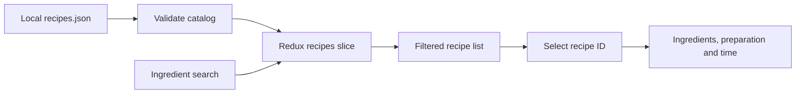

# 🧪 Exercise - Recipe Finder

<div align="center">


</div>

**Pantry Notes** is a small React and TypeScript recipe finder. I can search ingredients, choose a recipe and read its quantities, preparation steps and total time. Redux Toolkit owns the catalog, search and selected recipe.

## ▶️ How to run

From this folder, with Node.js 22.13+ or 24+:

```bash
npm ci
npm run dev
```

Open the loopback URL printed by Vite. To create and serve the production build:

```bash
npm run build
npm run preview
```

The build runs strict TypeScript checking before bundling. Vite copies `public/recipes.json` into the output; keep it beside the built HTML. Both development and preview bind to `127.0.0.1` by default. No API key, account or external recipe service is needed. Run the app through HTTP rather than opening `index.html` directly from disk.

## 🎯 The challenge

| Part                                        | What it does                                                                                      |
| ------------------------------------------- | ------------------------------------------------------------------------------------------------- |
| `recipesSlice.ts`                           | Stores the loading state, validated recipes, applied ingredient query and selected ID.            |
| `loadRecipes()`                             | Reads local JSON asynchronously, prevents duplicate in-flight loads and supports retry.           |
| `selectVisibleRecipes()`                    | Finds recipes whose ingredient names contain every search term.                                   |
| `selectRecipe()` / `selectSelectedRecipe()` | Selects a real catalog entry and derives its full detail.                                         |
| `parseCatalog()`                            | Checks record shape, unique IDs, nonempty quantities/steps and positive integer minutes/servings. |
| `App.tsx`                                   | Presents search, list, details, loading, no matches, empty catalog and retryable errors.          |

Search terms are separated by spaces or commas. Matching ignores case and accents, uses partial ingredient-name matches and requires **all** terms. For example, `LEMON, CHICKPEA` finds one recipe; `lemon` finds two. A blank search shows the entire collection. Recipe descriptions and titles are not used to guess ingredient matches.

The six recipes and interface copy are original sample data, not a course dataset. All preparation times are illustrative total minutes. This finder is independent of the editable RecipeBookApp in Week 10.

## 🧩 State and interface



The loading state lasts for the real file request; there is no artificial waiting timer. Invalid JSON and HTTP/network failures show an explanatory message and a retry button. A valid empty JSON array has its own empty-shelf message. Applying another search clears the previous selection.

The layout adapts from a list/detail pair to one column on small screens. Search has a visible label, counts are announced, recipe buttons expose their selected state, opening details moves focus to the recipe heading and returning moves focus to the results heading. Reduced motion disables the loading animation and transitions. The bowl illustration is made with CSS; there are no remote images, fonts or tracking requests.

## 🧪 Tests

From this folder:

```bash
npm test
npm run build
npm audit
```

18 tests cover the real React tree and Redux store, asynchronous loading under StrictMode, ingredient search, selection, full details, keyboard focus, clearing, no matches, whitespace input, HTTP retry, network failure, malformed JSON, invalid records, an empty catalog and the shipped dataset's validation. Tests use jsdom and fetch fixtures; they do not claim to be browser rendering measurements.

## 🧠 What I learned

- A slice can hold shared data and IDs while selectors derive the current list and detail.
- TypeScript checks code, while runtime validation checks the JSON received by that code.
- Loading, failed loading, an empty collection and an unmatched search are different states.
- DOM tests can exercise the user flow with a real Redux store instead of replacing its hooks.

To practise explaining the code: trace `lemon, chickpea` from the form through `setQuery`, the selector and the selected detail. Then add one original recipe with a unique ID and run the tests.

---

## 👤 Author

**Kevin Cusnir 'Lirioth'**

Repository: [Fullstack2026](https://github.com/LiriothTeltanion/Fullstack2026)

Week 5 Remote Learning - TypeScript - Recipe Finder

Created: 2026-11-25, Asia/Jerusalem.
