# 🛰️ Remote Learning — TypeScript

The remote-learning set includes nine TypeScript fundamentals, a [React and Redux counter](Exercises/ExercisesXP/redux-counter/), and an [ingredient-based Recipe Finder](Exercises/RecipeFinder/).

## Contents

- [`Exercises/`](Exercises/)

- [Gold · Todo list](Exercises/ReduxPractice/ExercisesXPGold/)
- [Ninja · Practice profile](Exercises/ReduxPractice/ExercisesXPNinja/)

---

## 👤 Author

**Kevin Cusnir 'Lirioth'**  
Repository: [Fullstack2026](https://github.com/LiriothTeltanion/Fullstack2026)  
Week 5 Remote Learning - TypeScript
