# 💪 Daily Challenge - Actors

Not done yet. This folder is ready for the code, and the README will grow once it works.

**Status:** to do · Required for the course · 15 XP

## 📝 Plan

- [ ] Read the task on the course platform and write it down in my own words
- [ ] Write the code in this folder
- [ ] Fill in How to run, The challenge, Tests and What I learned, like the finished exercises

---

## 👤 Author

**Kevin Cusnir 'Lirioth'**  
Repository: [Fullstack2026](https://github.com/LiriothTeltanion/Fullstack2026)  
Week 6 Day 1 - Introduction to Databases - Daily Challenge
